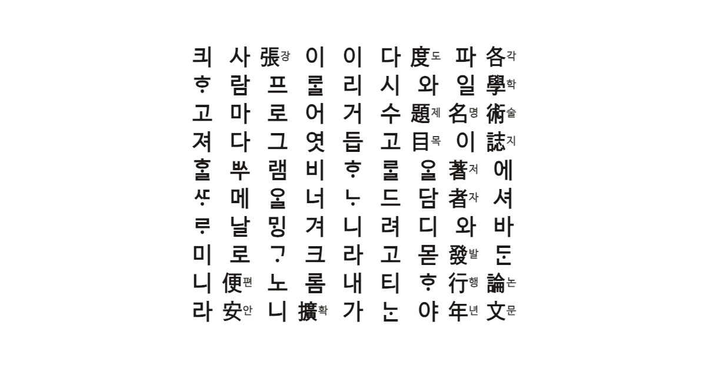

# 📑 논문 PDF 인용식 파일명 (Paper Rename Extension)

> 국내외 학술 DB 및 다양한 웹사이트에서 논문 PDF를 다운로드할 때, 현재 페이지의 서지정보를 분석하여 깔끔한 **인용식에 가까운 파일명으로 자동 변환하여 저장**하고 인용용 텍스트를 손쉽게 복사해 쓸 수 있도록 돕는 Chrome/Whale 브라우저 확장 프로그램(MV3)입니다.

---

## ✨ 주요 기능 및 특징

### 1. 🎓 학교별 설정 없이 도서관 프록시·내장 화면 처리
* 임의의 학교 프록시에 접근할 수 있도록 HTTP·HTTPS 매칭과 iframe 실행을 사용합니다. 실제 자동 처리는 학술 주소 또는 논문 서지 정보가 확인된 페이지에서만 시작합니다.
* 하이픈으로 바뀐 원본 호스트, URL 안에 포함된 원본 주소, blob 주소를 해석합니다. 원본 호스트가 드러나지 않으면 citation/DC 메타 태그나 ScholarlyArticle JSON-LD로 논문 페이지임을 확인합니다.
* 주소만으로 학술 여부를 알 수 없는 페이지에서는 서지 태그를 제한된 횟수로 확인합니다. 일반 페이지의 제목이나 Open Graph 정보만으로 클릭 감시·파일명 변경을 시작하지 않습니다. 원본 주소와 서지 정보를 모두 숨긴 뷰어 등은 자동 처리에 한계가 있습니다.

### 2. ⚡ 로그인 및 원문 뷰어 페이지 상태 무관 (State-Agnostic) 추출
* 로그인 과정이나 PDF 원문 뷰어 탭 등 어떤 상황이든 content 스크립트가 온전히 로드되어 팝업과 상시 통신합니다.
* **부모 창(Opener) 크로스 문서 파싱**: PDF 뷰어 탭 등 DOM 정보가 전무한 곳에서는 `window.opener`가 존재하고 Same-Origin 권한이 허용되면 부모 상세페이지의 `document`를 탐색해 메타데이터를 추출합니다.
* **오염 방지**: 로그인 페이지와 비어 있는 뷰어의 정보를 논문 서지 정보로 수집하지 않습니다.

### 3. 🌐 사이트별 셀렉터에 기대지 않는 범용 메타데이터 추출기 (JSON-LD 지원)
* 개별 지원 규칙이 없는 학술 사이트, 대학 도서관 프록시, dCollection 원문 페이지에서도 서지 정보를 포기하지 않고 긁어옵니다. 사이트가 마크업을 바꿔 전용 셀렉터가 깨져도 이 경로가 받아냅니다.
* **JSON-LD (Schema.org) 파서 탑재**: 현대의 많은 웹사이트들이 활용하는 `<script type="application/ld+json">` 태그를 분석하여 논문 및 기사 객체(`ScholarlyArticle`, `Article` 등)로부터 저자, 제목, 연도, 발간처, 학술지명, 쪽수 정보를 고정밀도로 추출합니다.
* Dublin Core (`DC.*`), Open Graph (`og:*`) 및 일반 HTML SEO 메타 태그 스캔을 함께 병합합니다.
* **본문 및 제목 역추적**: 메타 태그가 없는 최악의 원시 웹페이지에서도 글 제목은 `<title>` 태그에서 본제목/부제목으로 나누고, 연도는 본문 전체 텍스트에서 4자리 연도를 역추적 파싱합니다.
* **단어 하이픈 결합 보호**: 제목 분할 시 `JSON-LD`, `deep-learning` 같은 단어 내부의 하이픈이 부제목 구분자로 오인되어 제목이 잘려 버리는 현상을 정밀 정규식 필터로 완벽히 방지합니다.
* **불필요한 접두사 및 영문명 자동 정제**:
  - 제목 맨 앞의 `[논문]`, `[학위논문]`, `[연구보고서]` 등 시스템용 대괄호 접두사를 자동으로 감지하여 제거합니다.
  - 학술지명에 병기되어 있는 등호 뒷부분 영문 풀네임(예: `= Journal of...`) 및 괄호 영문명(예: `(Journal of...)`)을 자동으로 걷어내어 한글 학술지명만 깔끔하게 정제합니다.
* **학위논문 대학명 복원 엔진**: 학위논문사항에 대학교 명칭이 누락되고 `학위논문(석사)` 형태로만 기재되어 있는 특수한 경우, 발행기관(예: `서울시립대학교 일반대학원`) 필드를 분석하여 진짜 대학교 이름(`서울시립대학교`)을 정상적으로 유추 및 복원해 냅니다.

### 4. 🗂️ 원클릭 인용/파일명 프리셋(Preset) 선택 및 사용자 지정 저장
팝업 설정 탭 맨 상단에서 상황에 알맞은 프리셋을 마우스 클릭 한 번으로 손쉽게 전환하여 즉시 적용할 수 있습니다.
* **사용자 프리셋 동적 저장/삭제**: 드래그 앤 드롭으로 칩 순서를 수동 변경한 후 **[저장]** 버튼을 누르면 새 프리셋 이름을 지정해 크롬 동기화 스토리지(`chrome.storage.sync`)에 영구히 저장할 수 있으며, 불필요한 사용자 프리셋은 **[삭제]** 버튼으로 손쉽게 제거할 수 있습니다.
* **기본 제공 표준 레퍼런스 템플릿**:
  1. **기본 확장 양식 (기본값)**: `저자, 연도, 「제목」, 『학술지명』 권(호), 발행기관` (쪽수 기본 제외)
  2. **표준 학술지 양식 (연도 후순형)**: 국내 학계 논문지 투고 시 가장 보편적인 한국식 레퍼런스 포맷 (`저자, 「제목」, 『학술지명』 권(호), 발행기관, 연도`)
  3. **연도 우선 정렬 양식 (파일 관리용)**: 로컬 탐색기 내에서 파일들을 연도별로 편리하게 관리/정렬할 수 있는 `연도, 저자, 제목` 포맷 (기존 언더바 `_` 에서 쉼표 `, ` 로 교정)
  4. **APA 양식 (Global Standard)**: 해외 저널 인용 표준인 APA 스타일 (`저자 (연도), 제목, 학술지명, 권호`)
  5. **Chicago 양식 (Global Standard)**: 역사/인문학 표준 시카고 스타일 포맷 (`저자, 연도, 제목, 학술지명, 권호, 발행기관`)
  6. **IEEE 양식 (Global Standard)**: 이공계/IT 계열 표준 IEEE 포맷 (`저자, 제목, 학술지명, 권호, 연도`)
* *Note: 드래그 앤 드롭으로 칩 순서를 수동 변경하거나 쪽수 포함 여부를 바꿀 경우 프리셋이 `-- 사용자 정의 (custom) --` 상태로 자동 연동됩니다.*
* **학위논문(Thesis) 학과명 세부 표시 설정**: 학위논문의 경우 대학(원) 명칭과 학위 구분(석사/박사)이 서지 정보로서 매우 중요하므로, 상세페이지의 학위논문사항을 정밀 파싱하여 파일명 및 인용구에 병합 표기합니다. 사용자의 기호에 맞춰 팝업의 설정 탭에서 학과명 출력 형식을 실시간으로 제어할 수 있습니다:
  - **표시 안 함**: 예시) `서울시립대학교 석사학위논문` (기본값)
  - **학과명 표시**: 예시) `서울시립대학교 국사학과 석사학위논문`

### 5. 🚫 일상 포털 사이트 정보 오염 방지 및 수동 조립기 제공
* 네이버, 다음, 구글 검색 등 일상적인 웹서핑 및 학술 사이트 메인 페이지에서 팝업을 켰을 때 지저분한 메인 타이틀이나 무의미한 검색창 텍스트, 저작권 문구(Copyright 등)가 인용 폼에 채워지는 현상을 완전히 방지했습니다.
  - **학술 사이트 메인 페이지 예외 처리**: RISS, DBpia, KCI 등의 초기 메인 화면(index.do 등)을 자동 감지하여 서지 정보 추출을 건너뛰고 빈 폼으로 대기합니다.
  - **카피라이트 및 사이트 홍보 문구 필터**: 메타데이터 추출기에서 `Copyright`, `ALL RIGHTS RESERVED`, `대국민 서비스`, `학술연구정보서비스` 등 저널과 무관한 시스템 텍스트를 정교하게 거릅니다.
* 학술 화이트리스트 외의 비학술 사이트나 학술 사이트 메인에서는:
  1. 비학술 사이트의 경우 팝업 상단에 `⚠️ 이 페이지는 학술 사이트가 아닙니다.` 라는 경고 배너를 띄웁니다.
  2. 폼 필드를 깨끗하게 비운 상태로 시작하여, 필요한 경우 사용자가 직접 수동으로 정보를 기입하여 파일명이나 인용 텍스트를 만들 수 있는 **수동 조립기** 역할을 수행합니다.

### 6. 📚 사이트가 제공하는 정규 서지(BibTeX · RIS) 우선 사용
* 국내 학술 DB 대부분은 "인용하기 / 내보내기"에 **BibTeX·RIS 블록**을 페이지 안에 담고 있습니다. 사이트가 스스로 만들어 주는 정규 서지 데이터라, 화면 마크업이 바뀌어도 잘 깨지지 않습니다.
* 이 확장은 상세페이지에서 그 블록을 찾아 **전용 셀렉터보다 먼저 신뢰**합니다. 중첩 중괄호(`title = {제목 {안쪽}}`), `and`로 이어진 저자, `15--42` 형태의 쪽 범위, `@phdthesis`/`@mastersthesis` 학위논문 엔트리를 모두 처리합니다.
* 값이 있는 필드만 덮어쓰므로, 블록이 일부만 채워져 있어도 나머지는 기존 추출 결과가 유지됩니다.
* 페이지의 `<style>` 안에 있는 `@media`·`@import` 같은 CSS 블록을 BibTeX로 오인하지 않도록 알려진 엔트리 타입만 인식합니다.

### 7. 🔗 DOI → Crossref 서지 보강 (선택, 기본 꺼짐)
* 사이트에서 읽지 못한 칸이 있고 DOI가 확인되면, Crossref 공개 API에 조회해 **비어 있는 칸만** 채웁니다.
* 국내 논문은 Crossref에 영문 제목·영문 학술지명만 등록된 경우가 많으므로, **사이트가 준 한글 값은 절대 덮어쓰지 않습니다.**
* 조회는 상세페이지를 열 때 미리 이루어지므로 **다운로드가 네트워크를 기다리지 않습니다.** 3초 타임아웃과 같은 DOI 재조회 방지(10분)가 걸려 있습니다.
* 요청에는 DOI만 담기고 쿠키를 보내지 않지만(`credentials: "omit"`), 어떤 논문을 보는지가 제3자에게 전달되는 것은 사실이므로 **기본값은 꺼짐**입니다. 팝업 설정 탭에서 켤 수 있습니다.

### 8. 🗂️ 하위 폴더 자동 정리
* 팝업 설정의 **저장 폴더**에 경로를 적으면 다운로드 폴더가 어지러워지지 않습니다. 비워 두면 기존과 같이 최상위에 저장합니다.
* `{year}` 자리표시자로 발행연도별 정리가 됩니다. 예) `논문/{year}` → `논문/2025/저자, 2025, 「제목」….pdf`
* 연도를 모르는 논문은 그 조각만 빠집니다(`논문/`). 상위 디렉터리 탈출(`..`), 절대경로, 예약 문자는 모두 정리되어 다운로드 폴더 밖으로 나갈 수 없습니다.
* OS의 길이 제한은 경로 전체가 아니라 조각마다 걸리므로, 폴더 접두사는 파일명 길이 예산 계산이 끝난 뒤에 붙습니다.

### 9. 📤 Zotero · EndNote로 바로 넘기는 서지 내보내기
* 서지정보 탭에서 현재 논문을 **BibTeX / RIS로 복사**하거나 **`.bib` / `.ris` 파일로 저장**할 수 있습니다.
* 파일명은 설정한 파일명 규칙을 그대로 따르므로 PDF와 짝이 맞습니다.
* 인용 키는 한글 저자도 구분되도록 만듭니다(`김영희2025근대`). ASCII만 남기면 국내 논문이 전부 `paper2025`로 충돌해 `.bib` 라이브러리가 망가집니다.
* 학위논문은 `@phdthesis`/`@mastersthesis`(RIS는 `TY  - THES`)로 내보냅니다.

### 10. 💾 3개 OS에서 안전한 파일명 길이 처리
* 파일명 길이 한도는 OS마다 세는 단위가 다릅니다. **Windows(NTFS)는 255 UTF-16 단위**라 문자 수가, **macOS(APFS)·리눅스(ext4 등)는 255바이트**라 UTF-8 바이트 수가 먼저 걸립니다.
* 한글은 UTF-8에서 3바이트이므로 문자 수만 세면 180자 = 540바이트가 되어 macOS·리눅스에서는 제안한 파일명이 잘리거나 통째로 무시됩니다.
* 이 확장은 서비스 워커에서 실행 플랫폼을 판별해 **필요한 OS에서만 UTF-8 바이트 상한(235바이트)을 함께 적용**합니다. Windows에서는 사용자가 설정한 문자 수 한도가 그대로 유지되고, macOS·리눅스에서는 길이 초과로 이름이 깨지지 않습니다.
* 자르는 위치는 코드포인트 경계라 서로게이트 페어가 반쪽만 남지 않고, 확장자 몫은 예산에서 먼저 빼둡니다.

### 11. 🎨 아기자기한 슬림 UI & Absolute Overlay 복사 버튼
* 가로 **`400px`**과 세로 **`550px`**의 콤팩트하고 아기자기한 레이아웃을 제공합니다.
* 복사 버튼을 인풋 필드 내부 우측에 포개는 **Absolute Overlay** 구조로 리팩토링하고 우측 패딩(`padding-right: 45px`)을 충분히 확보하여, 긴 텍스트 입력 시에도 복사 버튼 아래로 글자가 겹쳐 찌그러져 잘려 보이는 현상을 완벽히 제거했습니다.
* 마우스를 올리면 원본 전체 텍스트가 툴팁으로 뜨며, 입력란 클릭 시 전체가 자동 선택되어 편집과 복사가 극도로 유연합니다.
* **보색(Complementary) 대비 색상**: 색상휠에서 세련된 대조를 이루며 시각적으로 화사하면서도 피로도가 적은 **인디고 블루(Indigo)**와 **엠버 오렌지(Amber)** 조합을 적용했습니다.

---

## 🛠️ 지원 학술 사이트 목록

* **RISS** (`riss.kr`)
* **DBpia** (`dbpia.co.kr`, `dbpia.com`)
* **KISS** (`kiss.kstudy.com`)
* **KCI** (`kci.go.kr`)
* **e-article** (`earticle.net`)
* **교보문고 스콜라** (`scholar.kyobobook.co.kr`)
* **KoreaScience** (`koreascience.or.kr`)
* **ScienceON** (`scienceon.kisti.re.kr`)
* **KRM 기초학문자료센터** (`krm.or.kr`)
* **국회도서관** (`nanet.go.kr`)
* **국립중앙도서관** (`nl.go.kr`)
* **서울역사아카이브 연구 논문** (`history.seoul.go.kr`)
* **Google 학술 검색** (`scholar.google.co.kr`)
* **dCollection** (대학별 자체 도서관 학위논문 서비스)
* *및 상기 사이트들이 연동되는 국내 모든 대학교 도서관 프록시 도메인*

---

## 🤝 archreport(국가유산 보고서 파일명 정리)와 함께 쓰기

두 확장을 함께 설치해도 설치 순서와 상관없이 같은 결과가 나옵니다(0.2.0부터).

| 다운로드 | 결과 파일명 |
|---|---|
| 국가유산 보고서 (e-minwon, heritage/cha/khs, nrich, cihc, iha) | 보고서 인용식 (archreport) |
| 학술 논문 (RISS, KCI, DBpia 등, 학교 프록시 포함) | 논문 인용식 (paper-rename) |
| e-minwon ZIP 일괄다운로드 | ZIP 취소 후 개별 보고서 인용식 |
| 관련 없는 일반 다운로드 | 원본 유지 |

### 왜 예전에는 "됐다가 안 됐다가" 했나

크롬은 `downloads.onDeterminingFilename` 리스너를 가진 확장이 여럿이면 **나중에 설치된 확장의 결정**을 씁니다. 실제 크로미움으로 확인해 보니, 나중 확장이 이름을 제안하지 않아도(아무것도 바꾸지 않겠다고 답해도) 그 "제안 없음"이 이깁니다. 0.1.x는 "각자 자기 몫만 이름을 제안하면 겹치지 않는다"는 전제로 만들어져 있었습니다.

* 논문 확장을 **나중에** 설치한 경우: 논문 확장의 리스너가 항상 켜져 있어 국가유산 보고서 이름이 매번 원래 이름으로 돌아갔습니다.
* 보고서 확장을 **나중에** 설치한 경우: 국가유산 페이지를 연 뒤 약 2분 동안은 보고서 확장의 리스너가 켜져 있어, 그 사이 내려받은 논문은 이름이 바뀌지 않았습니다.

### 0.2.0: 서로 물어서 같은 이름을 제안하는 공존 프로토콜

두 확장은 다운로드마다 서로에게 "너라면 이 파일을 뭐라고 부르겠니"를 묻고(`src/coop.js`, 두 저장소에서 동일한 파일), 같은 규칙으로 최종 이름 하나를 고른 뒤 **둘 다 그 이름을 제안**합니다. 누가 이기든 결과가 같습니다.

* 국가유산 보고서 사이트에서 시작된 다운로드는 보고서 이름, 그 밖에는 논문 이름이 우선합니다.
* 상대 확장은 웹스토어 ID로 찾습니다. 개발자 모드(압축해제) 설치처럼 ID가 다른 경우에는 국가유산 사이트를 한 번 열면 두 확장이 서로의 ID를 알게 되고 이후로는 기억합니다.
* 상대에게 보내는 내용은 다운로드 주소·파일명 등 크롬이 두 확장 모두에게 이미 알려주는 다운로드 정보뿐이며, 외부 서버로는 아무것도 보내지 않습니다.
* 한쪽이 꺼져 있거나(OFF) 응답이 늦어도 최대 몇 초 안에 다운로드는 진행됩니다.

함께 사용하는 archreport도 **0.2.0 이상**으로 갱신하세요. 한쪽만 0.2.0이면 예전 충돌이 남을 수 있습니다. `src/site-policy.js`와 `src/coop.js`는 두 저장소에서 동일하게 유지해야 합니다.

### 학교 포털·프록시·iframe

학교별 도메인 목록 없이 하이픈으로 바뀐 학술 호스트, URL 파라미터/경로에 들어 있는 원본 주소, blob 주소를 판별합니다. 포털 iframe에서도 페이지 정보를 수집하고 팝업은 현재 탭의 서지 정보를 사용합니다. HTTP 프록시도 지원하기 위해 HTTP 페이지 접근 범위를 추가했습니다.

호스트를 알아볼 수 없는 프록시와 출판사에서는 citation/DC 메타 태그의 제목·저자·발행 정보 또는 ScholarlyArticle JSON-LD가 확인되어야 자동 동작합니다. 단순 페이지 제목만으로 논문이라고 추정하지 않습니다. 학술 호스트 밖의 다운로드는 수집된 PDF 주소 또는 논문 페이지 referrer와 정확하게 연결되어야 이름을 변경합니다.

인증된 학교 포털 전체를 실측한 것은 아닙니다. 사이트가 주소와 서지 정보를 모두 숨기거나, 사이트 접근 권한이 제한됐거나, 서지 정보를 제공하지 않는 뷰어는 자동 처리가 제한될 수 있습니다. 사이트 접근 권한을 허용하고 확장 업데이트 후 열려 있던 포털/논문 페이지를 새로고침하세요. 웹스토어판과 개발자 모드판을 중복 활성화하지 마세요.

## 🚀 설치 방법

1. 크롬 또는 웨일 브라우저 주소창에 `chrome://extensions`를 입력해 확장 프로그램 관리 페이지를 엽니다.
2. 우측 상단의 **개발자 모드** 토글을 켭니다.
3. 좌측 상단의 **압축해제된 확장 프로그램을 로드합니다** 버튼을 누릅니다.
4. 이 프로젝트의 루트 폴더( `manifest.json`이 포함된 폴더 )를 선택하여 추가합니다.

---

## 📦 웹스토어 업로드용 zip 만들기

`tools/build-zip.bat`을 더블클릭하면 저장소 최상위에 `paper-rename-extension-<버전>.zip`이 생깁니다. 압축을 풀지 않고 그대로 웹스토어에 올리면 됩니다.

* `manifest.json`이 실제로 참조하는 파일과, 그 HTML이 부르는 로컬 스크립트·스타일만 담습니다. 테스트, README, 아이콘 원본 등 런타임에 쓰이지 않는 파일은 빠집니다.
* 참조된 파일이 하나라도 없으면 zip을 만들지 않고 멈춥니다.
* 같은 소스면 항상 같은 zip이 나오도록 타임스탬프를 고정합니다.
* Windows는 PowerShell로 동작하며 별도 설치가 필요 없습니다. 실패하면 자동으로 Python으로 넘어갑니다.
* macOS·리눅스에서는 `python3 tools/build_zip.py`를 직접 실행하세요.

---

## 🧪 테스트 실행

제공되는 테스트 러너를 통해 메타데이터 추출기 및 파일명 조립, context 매칭 등의 신뢰성을 단위 테스트로 검증할 수 있습니다.

```powershell
# Node.js가 설치된 상태에서 프로젝트 루트 경로로 이동 후 실행
node tests/run-tests.js
```

현재 인용식 렌더링, 파일명 정리, 다운로드 context 매칭, 각 지원처 fixture 기반 메타데이터 추출, JSON-LD 파싱, 도메인 필터링 등을 포함한 **총 123개의 단위 테스트**가 포함되어 있습니다.

---

## 📝 참고 및 크레딧

이 프로젝트는 `danhyun-jeong/sickle-cite`와 `lzpxilfe/archreport`의 아이디어와 동작 구조를 참고하여 MV3 환경에 알맞게 새로 설계 및 구현되었습니다.

## Citation

이 저장소가 연구, 수업, 현장 업무에 도움이 되었다면 GitHub의 **Cite this repository** 버튼으로 인용해 주세요.

[](https://github.com/lzpxilfe/paper-rename-extension)
[](https://github.com/lzpxilfe/paper-rename-extension)

인용 메타데이터는 [CITATION.cff](CITATION.cff)에 보관합니다.


## 0.2.0: 접근 경로와 무관하게 정확한 이름으로

실제 크로미움에 두 확장을 함께 올리고 다운로드 경로 34가지(같은 탭·새 탭·원문보기 팝업·숨은 iframe·blob·POST·주소 직접 입력·서비스 워커가 잠든 상태·학교 프록시 3종·구글 학술검색)와 지원 사이트 13곳 × 접속 방식 3가지(직접·학교 프록시 호스트·경로 감싸기 프록시)를 두 설치 순서로 자동으로 돌려 보며 고쳤습니다(`tools/e2e`).

* **두 확장 충돌 해소**: 위의 공존 프로토콜. 설치 순서와 무관합니다.
* **탭 계보 추적**: 원문보기·뷰어가 새 탭이나 팝업으로 열려도, 그 창을 연 논문 페이지를 따라 올라가 서지를 찾습니다. RISS에서 원문보기를 누르면 DBpia·KISS 등 다른 사이트 창이 열리는 경우도 포함합니다. 예전에는 부모 페이지 정보가 5초보다 오래되면(=상세페이지를 읽다가 누르면) 버렸습니다.
* **페이지 이동 순간 정보 삭제 버그 수정**: 탭이 로딩을 시작할 때마다 그 탭의 논문 정보를 지웠는데, 다운로드 링크를 누르는 순간에도 탭은 로딩 상태가 되어 클릭 타이밍에 따라 이름이 바뀌거나 말았습니다.
* **KCI 원문 미리보기 팝업**: 팝업 창 제목(「한국학술지인용색인」)을 논문 제목으로 쓰던 문제를 고쳤습니다. 사이트 이름·버튼 문구("원문 PDF 다운로드")는 제목으로 쓰지 않고, 같은 출처 부모 창의 서지를 씁니다.
* **KCI·ScienceON 상세페이지**: 주소에 `Search`/`Srch`가 들어 있다는 이유로 검색 목록으로 오인해 페이지 정보를 미리 담지 않던 문제를 고쳤습니다.
* **RISS 상세페이지**: 주소에 `/search/`가 들어 있어 검색 목록처럼 버튼 주변 글자를 제목으로 쓰던 문제를 고쳤습니다.
* **확장자**: 다운로드 주소의 끝(`.kci`, `.do`)이 아니라 실제 파일 형식(Content-Disposition·MIME)으로 확장자를 정합니다.
* **같은 논문 ID 판별**: `sereArticleSearchBean.artiId`처럼 감싼 파라미터도 인식하고, RISS는 자료 유형 코드(`p_mat_type`)가 아닌 `control_no`로 논문을 구분합니다. 다른 논문 ID를 가리키는 다운로드에는 그 정보를 쓰지 않습니다.
* **원 주소를 숨기는 학교 프록시**: 학술 DB 고유의 경로 모양(`/kciportal/`, `/search/detail/DetailView.do` 등)과 문서의 흔적으로 사이트를 알아봅니다.
* **구글 학술검색**: 결과 한 줄에서 제목·저자·학술지·연도를 읽어 [PDF] 링크로 받은 파일에 붙입니다.
* **주소만 바뀌는 페이지(SPA)**: 페이지를 새로 읽지 않고 다른 논문으로 넘어가도 다시 담습니다.
* **서비스 워커 재시작에 강하게**: 수집 정보와 탭 관계를 `storage.session`(브라우저를 닫으면 사라지고 디스크에 남지 않음)에 둡니다.
* 새 권한 `webNavigation`: 팝업·새 탭이 어느 탭에서 열렸는지 정확히 알기 위해 씁니다. 방문 기록을 따로 저장하거나 보내지 않습니다. 기존 `tabs` 권한과 같은 경고 문구라 업데이트 때 권한을 다시 묻지 않습니다.
* 개발자 모드 ID 고정: `manifest.json`의 `key`로 저장소 폴더를 그대로 올려도 ID가 일정해 두 확장이 바로 서로를 찾습니다. 웹스토어 업로드 zip(`tools/build-zip.*`)에서는 `key`를 자동으로 뺍니다.

## 0.1.7: 학위논문에서 학술지 항목 제외

학위논문은 학술지명과 권호를 파일명·인용문에 넣지 않습니다. 페이지의 검색 안내 문구가 학술지명으로 잘못 수집됐거나 이전 버전의 정보가 남아 있어도 제외합니다. 제목의 학위논문용 괄호 설정과 대학·학위 정보는 유지합니다. 예: `홍길동, 2025, 『학위논문 제목』, 한국대학교 석사학위논문.pdf`. BibTeX·RIS 내보내기에도 같은 판정을 적용하며, 일반 학술논문의 학술지 표기는 유지합니다.

## 회귀 테스트

`npm ci` 후 `npm test`를 실행합니다. DOM 검증용 linkedom은 개발 의존성이며 배포 ZIP에 포함되지 않습니다. 프록시·서지정보 추출·iframe 메시지·다운로드·OFF·시간 제한·학위논문 표기를 검증합니다.

두 저장소를 나란히 체크아웃한 경우 `node tests/coexistence.cjs ../archreport`로 양쪽 실제 서비스 워커를 Chrome API 모의 환경에서 함께 실행합니다. 크롬의 실제 규칙(나중에 설치된 확장의 결정이 최종)을 흉내 내어, 두 설치 순서·웹스토어 ID·개발자 모드 ID 모두에서 최종 파일명이 맞는지 확인합니다.

실제 브라우저 검증은 `tools/e2e`에 있습니다. 크로미움에 두 확장을 함께 올리고 가짜 학술·국가유산 사이트를 로컬에 띄워 실제로 내려받은 파일명을 확인합니다(`tools/e2e/README.md`).
